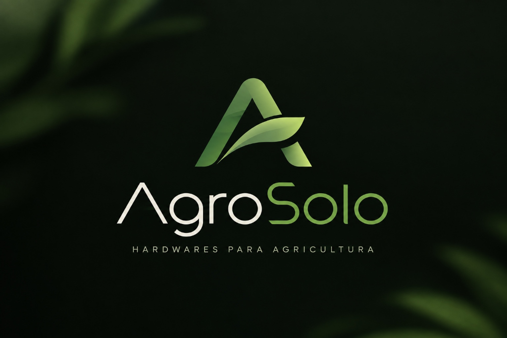
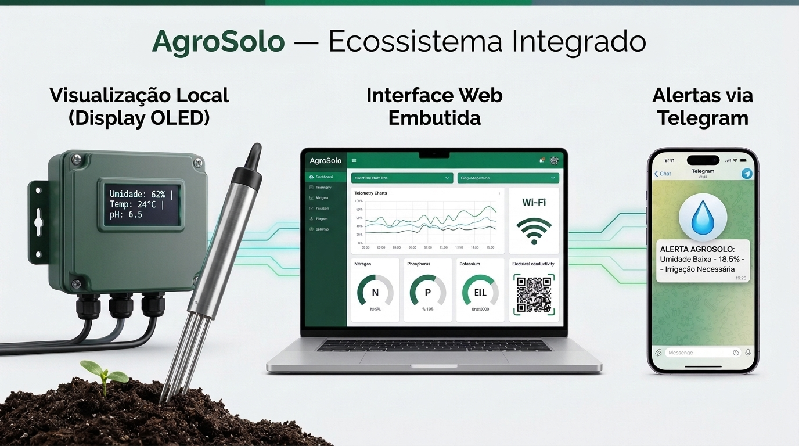
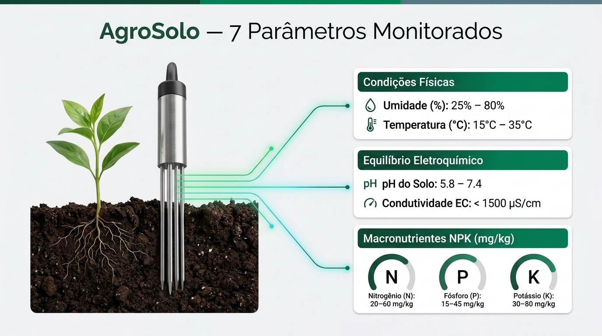
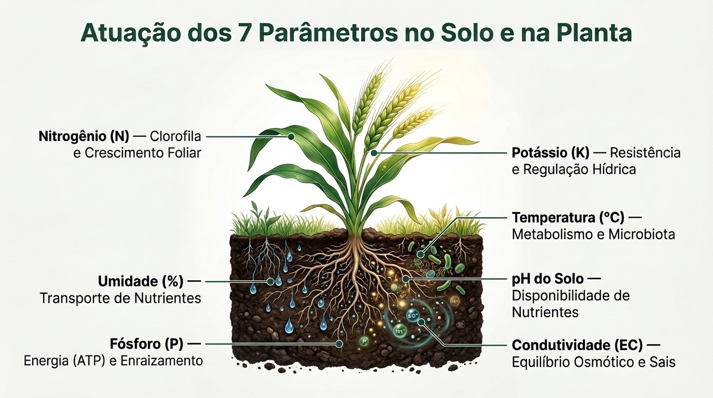

# 🌱 AgroSolo — Sistema Inteligente de Telemetria e Monitoramento de Solo IoT

<p align="center">
  
</p>

<p align="center">
  <b>Engenharia de Software & Internet das Coisas (IoT) — Projeto 2P</b><br>
  <i>Monitoramento multiparamétrico edáfico em tempo real via ESP32, Modbus RTU RS-485, Display OLED, Dashboard Web e Notificações Telegram.</i>
</p>

<p align="center">
  
  
  
  
  
  
</p>

---

## 📌 Sumário
1. [Resumo do Problema e Solução](#-resumo-do-problema-e-solução)
2. [Integrantes da Equipe](#-integrantes-da-equipe)
3. [Arquitetura da Solução](#-arquitetura-da-solução)
4. [Hardware Utilizado e Pinagem](#-hardware-utilizado-e-pinagem)
5. [Documentação da API e Comunicação](#-documentação-da-api-e-comunicação)
6. [Instruções de Instalação e Execução](#-instruções-de-instalação-e-execução)
7. [Screenshots e Demonstração](#-screenshots-e-demonstração)

---

## 🚜 Resumo do Problema e Solução

### O Problema
Na agricultura tradicional e de precisão, a tomada de decisão sobre **irrigação, calagem e adubação (NPK)** frequentemente é realizada com base na intuição empírica ou em laudos laboratoriais lentos, que podem levar semanas entre a coleta e o resultado. Essa defasagem temporal acarreta:
* **Desperdício de recursos hídricos:** Irrigação excessiva ou insuficiente por desconhecimento da umidade exata do solo.
* **Degradação química do solo:** Acidificação acentuada, alcalinização ou salinização por condutividade elétrica (EC) desbalanceada.
* **Desperdício e contaminação de insumos:** Aplicação incorreta de adubos químicos (Nitrogênio, Fósforo e Potássio), elevando custos e causando lixiviação de nutrientes no lençol freático.
* **Queda de produtividade da safra:** Perdas financeiras evitáveis decorrentes de estresse hídrico e nutricional da planta.

### A Solução: AgroSolo
O **AgroSolo** é uma estação IoT embarcada autônoma que realiza o **sensoriamento edáfico em tempo real de 7 parâmetros agronômicos essenciais** através de uma sonda industrial de aço inoxidável:
1. **Umidade do Solo (%)**
2. **Temperatura do Solo (°C)**
3. **Condutividade Elétrica / Salinidade ($\mu$S/cm)**
4. **Potencial Hidrogeniônico (pH)**
5. **Nitrogênio assimilável - N (mg/kg)**
6. **Fósforo assimilável - P (mg/kg)**
7. **Potássio assimilável - K (mg/kg)**

Os dados são adquiridos por protocolo industrial **Modbus RTU sobre barramento diferencial RS-485**, processados na borda (*edge computing*) pelo microcontrolador **ESP32**, exibidos localmente em um **display gráfico OLED SSD1306**, transmitidos a um **Dashboard Web SPA interativo** servido pela própria memória Flash do microcontrolador e monitorados continuamente com envio automatizado de **alertas inteligentes via Telegram**.

---

## 👥 Integrantes da Equipe

| Nome Completo | Registro Acadêmico (RA) | Função Principal |
| :--- | :---: | :--- |
| **André Marschal Vieira** | `[Inserir RA]` | Firmware Embarcado, Arquitetura IoT & Integração de Hardware |
| **Enzo Nakakogue** | `[Inserir RA]` | Modelagem de Dados, Regras Agronômicas & Documentação |
| **Rafael Motta** | `[Inserir RA]` | Desenvolvimento do Dashboard Web & Engenharia de Frontend |
| **Vinicius Togni** | `[Inserir RA]` | Integração de Alertas Telegram & Protocolos de Rede |
| **Vicente Urban** | `[Inserir RA]` | Testes de Bancada, Validação de Hardware & Infraestrutura |

---

## 🏗️ Arquitetura da Solução

O sistema foi concebido sob uma arquitetura em camadas, garantindo isolamento galvânico entre os circuitos de sensoriamento de campo, o processamento de borda e a camada de consumo cliente:

```mermaid
flowchart TD
    subgraph Campo [" CAMADA 1: SENSORES DE CAMPO "]
        NPK["Sensor Industrial NPK 7 em 1<br>(Sonda Inox 316 / IP68)<br>Umid, Temp, EC, pH, N, P, K"]
    end

    subgraph Potencia [" CAMADA 2: GESTÃO ENERGÉTICA "]
        FonteUSB["Fonte USB 5V 2A / VBUS"]
        StepUp["Conversor DC-DC Boost (MT3608)<br>5V DC -> 12V DC Estabilizado"]
    end

    subgraph Condicionamento [" CAMADA 3: BARRAMENTO INDUSTRIAL "]
        MAX485["Transceiver RS-485 TTL (MAX485)<br>Half-Duplex Diferencial (Linhas A e B)<br>UART2 @ 4800 bps"]
    end

    subgraph Borda [" CAMADA 4: PROCESSAMENTO DE BORDA (ESP32) "]
        ESP32["Microcontrolador ESP32 DevKit V1<br>(Dual-Core 240MHz / FreeRTOS)<br>• Leitura e Decodificação Modbus RTU<br>• Servidor HTTP Embarcado (Porta 80)<br>• API REST JSON (/api/data)<br>• Gestor de Alertas com Cooldown"]
        OLED["Display OLED 0.96 pol SSD1306 (I2C)<br>• Status de Rede e Conectividade<br>• Link HTTP direto para o Dashboard<br>• Telemetria Local Resumida"]
    end

    subgraph Rede [" CAMADA 5: TRANSPORTE E CONECTIVIDADE "]
        WiFiRouter["Roteador Wi-Fi 2.4 GHz (802.11 b/g/n)"]
    end

    subgraph Clientes [" CAMADA 6: APLICAÇÃO E CLIENTES "]
        Navegador["Dashboard Web SPA (Chart.js)<br>Mobile / Tablet / Desktop"]
        Telegram["Telegram Bot API<br>Alertas de Solo Seco, pH, EC e Normalização"]
    end

    %% Conexões Elétricas e Físicas
    FonteUSB -->|5V DC| ESP32
    FonteUSB -->|5V DC| StepUp
    StepUp -->|12V DC| NPK

    %% Barramento de Comunicação
    NPK <-->|Par Trançado RS-485 A/B| MAX485
    MAX485 <-->|Sinais UART RX/TX + DE/RE| ESP32
    ESP32 <-->|I2C SDA/SCL 400kHz| OLED

    %% Conexão de Rede
    ESP32 <-->|Wi-Fi 2.4 GHz| WiFiRouter
    WiFiRouter <-->|HTTP / JSON (Porta 80)| Navegador
    WiFiRouter -->|HTTPS / TLS (Porta 443)| Telegram
```

### Fluxo de Operação
1. **Aquisição:** A cada 2 segundos, o ESP32 comuta o pino `PIN_DE_RE` (GPIO 5) para nível alto, transmitindo a requisição Modbus RTU ao sensor NPK via UART2 a 4800 bps.
2. **Processamento:** O ESP32 recebe a resposta de 19 bytes, valida os bytes de cabeçalho, decodifica os valores inteiros e fracionários e atualiza a telemetria em memória.
3. **Exibição Local:** O Display OLED SSD1306 (I2C pinos 21 e 22) renderiza o link HTTP para o usuário digitar no navegador do celular (`http://<IP_DO_ESP32>`) e exibe os valores resumidos de telemetria com indicador *heartbeat*.
4. **Serviço Web:** Qualquer dispositivo conectado à mesma rede Wi-Fi acessa a interface gráfica interativa do Dashboard Web em tempo real ou consome o endpoint REST `/api/data`.
5. **Vigilância Ativa:** Se um parâmetro violar a zona de conforto agronômica, o sistema despacha uma mensagem formatada em Markdown com diagnóstico e ações corretivas para o bot do Telegram do produtor rural (respeitando um *cooldown* de 10 minutos).

---

## 🛠️ Hardware Utilizado e Pinagem

### Lista de Componentes
1. **1x Microcontrolador ESP32 DevKit V1** (30 pinos, Dual-Core Tensilica Xtensa 32-bit LX6, 240 MHz, 520 KB SRAM).
2. **1x Sensor de Solo Industrial NPK 7 em 1** (Sonda com agulhas de aço inoxidável 316, proteção IP68 à prova d'água e corrosão, alimentação 9–24V DC).
3. **1x Módulo Conversor RS-485 para TTL (MAX485)** (Transceiver Half-Duplex para barramento diferencial).
4. **1x Módulo Regulador DC-DC Step-Up Boost (MT3608)** (Elevador de tensão de 5V para 12V DC regulado via trimpot).
5. **1x Display Gráfico OLED 0.96" SSD1306** (128x64 pixels monocromático, interface de comunicação I2C).
6. **1x Fonte de Alimentação USB 5V 2A** e cabo micro-USB de baixa resistência ôhmica.
7. **1x Protoboard 830 pontos** e jumpers de ligação rápida.

---

### Tabela Completa de Pinagem e Ligações Elétricas

| Módulo / Periférico | Pino do Módulo | Pino no ESP32 / Sistema | Descrição Funcional |
| :--- | :--- | :--- | :--- |
| **Display OLED SSD1306** | `VCC` | `3V3` (ou `VIN 5V`*) | Alimentação lógica do display |
| | `GND` | `GND` | Referência de aterramento comum |
| | `SCL` | `GPIO 22` | Barramento I2C Clock |
| | `SDA` | `GPIO 21` | Barramento I2C Dados |
| **Módulo MAX485 (TTL)** | `VCC` | `VIN` (5V) | Alimentação do transceiver RS-485 |
| | `GND` | `GND` | Referência comum |
| | `RO` (Receiver Out) | `GPIO 19` (RX2) | Recepção de dados serial UART2 |
| | `DI` (Driver In) | `GPIO 18` (TX2) | Transmissão de dados serial UART2 |
| | `DE` (Driver Enable) | `GPIO 5` | Habilita transmissão quando HIGH |
| | `RE` (Receiver Enable)| `GPIO 5` (junto ao DE) | Habilita recepção quando LOW |
| | `A` (Linha Não-Invertida)| Fio Amarelo do Sensor | Barramento diferencial RS-485 A(+) |
| | `B` (Linha Invertida) | Fio Azul do Sensor | Barramento diferencial RS-485 B(-) |
| **Módulo Step-Up (MT3608)** | `VIN (+)` | `VIN` (5V) | Entrada de tensão 5V da linha USB |
| | `VIN (-)` | `GND` | Referência de aterramento |
| | `VOUT (+)` | Fio Marrom do Sensor | **Saída ajustada em 12.0V DC** |
| | `VOUT (-)` | `GND` Comum | Terra unificado da alimentação |
| **Sensor NPK 7 em 1** | Fio Marrom (`VCC`) | `VOUT (+)` do Step-Up | Alimentação industrial (+12V DC) |
| | Fio Preto (`GND`) | `VOUT (-)` / `GND` | Terra comum unificado |
| | Fio Amarelo (`A+`) | Borne `A` do MAX485 | Sinal de dados positivo RS-485 |
| | Fio Azul (`B-`) | Borne `B` do MAX485 | Sinal de dados negativo RS-485 |

> **⚠️ Atenção de Engenharia:**  
> O trimpot multivoltas do módulo Step-Up MT3608 deve ser calibrado com o auxílio de um multímetro para **exatos 12.0V DC** antes de conectar o fio marrom do sensor. O sensor opera entre 9V e 24V; ajustar para 12V em vez de 24V reduz o consumo de corrente na entrada de 5V pela metade, evitando disparos do detector de *Brownout*.

---

## 📡 Documentação da API e Comunicação

### 1. Protocolo Industrial Modbus RTU (Camada Física RS-485)
* **Parâmetros de Linha:** 4800 bps, 8 bits de dados, sem paridade, 1 stop bit (8N1).
* **Requisição (Master $\rightarrow$ Sensor):**
  ```text
  01 03 00 00 00 07 04 08
  ```
  * `01`: Endereço do Escravo (Slave ID).
  * `03`: Função Modbus (*Read Holding Registers*).
  * `00 00`: Endereço inicial de memória do primeiro registrador.
  * `00 07`: Quantidade de registradores a serem lidos (7 registradores de 16 bits).
  * `04 08`: Checksum de redundância cíclica CRC-16 (Little Endian).

* **Mapeamento da Resposta (19 bytes):**
  * `Bytes [0..2]`: Endereço (`0x01`), Função (`0x03`), Contagem de Bytes (`0x0E` = 14 bytes de payload).
  * `Bytes [3..4]`: **Umidade** (Valor / 10.0 em %).
  * `Bytes [5..6]`: **Temperatura** (Inteiro com sinal / 10.0 em °C).
  * `Bytes [7..8]`: **Condutividade Elétrica** (Valor direto em $\mu$S/cm).
  * `Bytes [9..10]`: **pH** (Valor / 10.0).
  * `Bytes [11..12]`: **Nitrogênio** (mg/kg).
  * `Bytes [13..14]`: **Fósforo** (mg/kg).
  * `Bytes [15..16]`: **Potássio** (mg/kg).
  * `Bytes [17..18]`: Checksum de integridade CRC-16.

---

### 2. Endpoints HTTP do Servidor Web Embarcado (Porta 80)

#### `GET /` — Interface Gráfica do Dashboard
* **Descrição:** Retorna a aplicação web Single Page Application (SPA) completa armazenada na memória Flash (`PROGMEM`) do microcontrolador.
* **Content-Type:** `text/html; charset=UTF-8`
* **Recursos:** Renderiza cards de telemetria, gráficos históricos de umidade e temperatura via Chart.js, tabela de eventos e status operacional.

#### `GET /api/data` — Telemetria Consolidada em Tempo Real
* **Descrição:** Retorna a leitura edáfica mais recente no formato JSON estruturado.
* **Content-Type:** `application/json`
* **Headers:** `Access-Control-Allow-Origin: *` (CORS liberado para integração com frontends externos).

**Exemplo de Resposta JSON:**
```json
{
  "umidade": 48.5,
  "temperatura": 24.2,
  "ec": 380,
  "ph": 6.5,
  "n": 42,
  "p": 18,
  "k": 76,
  "sensor_ok": true,
  "leituras_ok": 1420,
  "leituras_err": 2,
  "uptime_s": 2840,
  "status": "ok"
}
```

#### `OPTIONS /api/data` — Pre-flight CORS
* **Descrição:** Responde requisições de pré-voo HTTP emitidas por navegadores web com código de status `204 No Content`.

---

### 3. Integração com Telegram Bot API
* **Método:** Chamada segura `HTTPS POST` para o endpoint:
  ```text
  https://api.telegram.org/bot<TELEGRAM_BOT_TOKEN>/sendMessage
  ```
* **Payload:** `chat_id=<CHAT_ID>&parse_mode=Markdown&text=<MENSAGEM>`
* **Matriz de Disparo e Limiares Agronômicos:**
  * **Umidade < 30.0%:** 💧 *Solo Seco* — Alerta de irrigação urgente.
  * **Umidade > 85.0%:** 🌊 *Solo Encharcado* — Alerta para suspender irrigação.
  * **Temperatura > 36.0°C:** 🔥 *Superaquecimento Edáfico*.
  * **Temperatura < 10.0°C:** ❄️ *Risco de Estresse por Frio / Geada*.
  * **Salinidade (EC) > 2000 $\mu$S/cm:** ⚡ *Salinidade Crítica*.
  * **pH < 5.0 ou pH > 8.2:** 🧪 *Acidez Extrema ou Alcalinização Excessiva*.
  * **Normalização:** Dispara notificação de recuperação quando os níveis retornam à faixa ideal.
  * **Controle Anti-Spam:** Mecanismo de *cooldown* de 10 minutos entre disparos repetidos.

---

## 💻 Instruções de Instalação e Execução

### Pré-requisitos
* [Visual Studio Code](https://code.visualstudio.com/) instalado.
* Extensão oficial do [PlatformIO IDE](https://platformio.org/) para VS Code.
* Driver USB-Serial instalado no computador (Silicon Labs CP210x ou WCH CH340).

---

### Passo a Passo de Compilação e Gravação

1. **Clonar o Repositório:**
   ```bash
   git clone https://github.com/SEU_USUARIO/Projeto-2P-AgroSolo.git
   cd Projeto-2P-AgroSolo
   ```

2. **Abrir o Projeto no VS Code / PlatformIO:**
   * Abra o VS Code e selecione `File` > `Open Folder...` apontando para a pasta raiz do projeto.
   * O PlatformIO identificará automaticamente o arquivo [`platformio.ini`](platformio.ini) e baixará as dependências:
     * `Adafruit SSD1306`
     * `Adafruit GFX Library`
     * `ArduinoJson`

3. **Configurar as Credenciais:**
   Abra o arquivo [`src/main.cpp`](src/main.cpp) e insira os dados da sua rede Wi-Fi e bot do Telegram:
   ```cpp
   // --- CONFIGURAÇÃO DA REDE WI-FI ---
   const char *WIFI_SSID = "NOME_DA_SUA_REDE";
   const char *WIFI_PASSWORD = "SENHA_DA_SUA_REDE";

   // --- CONFIGURAÇÃO DO BOT DO TELEGRAM ---
   const char *TELEGRAM_BOT_TOKEN = "SEU_BOT_TOKEN_AQUI";
   const char *TELEGRAM_CHAT_ID = "SEU_CHAT_ID_AQUI";
   ```

4. **Compilar o Firmware:**
   * Clique no ícone de verificação `✓` (PlatformIO: Build) na barra inferior do VS Code ou execute no terminal:
     ```bash
     pio run
     ```

5. **Gravar no ESP32:**
   * Conecte o ESP32 à porta USB do computador.
   * *(Recomendado: desconecte temporariamente o fio VIN do Step-Up durante a gravação para evitar sobrecorrente na porta USB)*.
   * Clique na seta `→` (PlatformIO: Upload) ou execute:
     ```bash
     pio run --target upload
     ```

6. **Monitorar a Execução:**
   * Abra o Monitor Serial a 115200 bps:
     ```bash
     pio device monitor -b 115200
     ```

7. **Acessar o Dashboard Web:**
   * Ao inicializar, o display OLED exibirá o IP atribuído pelo roteador:
     ```text
     +--------------------------------+
     | AGROSOLO 2P - WEB          (*) |
     | Acesse o Dashboard:            |
     | [ http://192.168.1.105       ] |
     |--------------------------------|
     | Umi: 48.5%   Temp: 24.2C       |
     | pH:  6.5     EC: 380 uS        |
     +--------------------------------+
     ```
   * Abra qualquer navegador no celular, tablet ou computador conectado à mesma rede e digite o endereço `http://<IP_DO_ESP32>`.

---

## 📸 Screenshots e Demonstração

### 1. Interface Web do Dashboard (Visualização Desktop & Mobile)
O Dashboard possui design com identidade visual em tons escuros e acentos esmeralda agronômicos, exibindo cards métricos, gráficos dinâmicos de tendência temporal com Chart.js e tabela de histórico recente.

<p align="center">
  
</p>

---

### 2. Parâmetros Agronômicos Monitorados e Ações
A plataforma analisa a fertilidade e a saúde do solo de ponta a ponta:

<p align="center">
  
  
</p>

---

### 3. Protótipo em Bancada & Display OLED
* Demonstração da montagem integrada com o microcontrolador ESP32 DevKit V1, transceiver MAX485, módulo Step-Up MT3608 e o display OLED SSD1306 exibindo a URL do painel e telemetria instantânea.

---

### 🎥 Vídeo Demonstrativo
> 📹 **Demonstração em Vídeo do Sistema em Operação:**  
> [Clique aqui para assistir ao vídeo no YouTube](https://youtube.com) *(Substitua pelo link da apresentação da equipe)*

---

<p align="center">
  Desenvolvido com dedicação pela equipe <b>AgroSolo — Projeto 2P</b> • 2026
</p>
